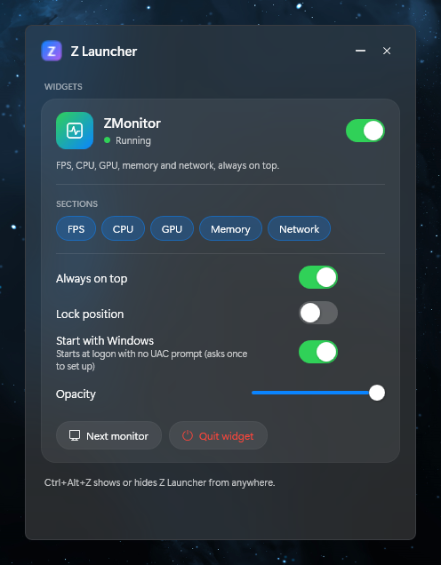
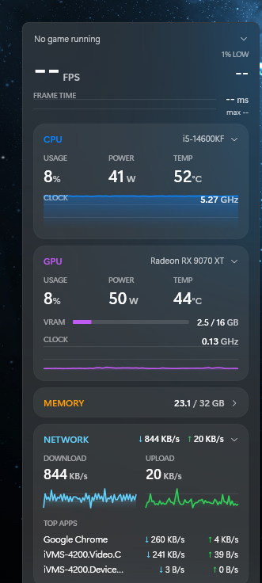

# Z Launcher

A frosted-glass launcher for Windows 11 with two sides behind a sliding pill: **Apps** and **Widgets**.

<table>
  <tr>
    <td align="center"></td>
    <td align="center"></td>
  </tr>
  <tr>
    <td align="center"><b>Z Launcher</b>: Widgets tab</td>
    <td align="center"><b>ZMonitor</b>: Memory collapsed, Network expanded</td>
  </tr>
</table>

> **For now Z Launcher only controls widgets:** the Apps side and the pill are hidden.
> To bring them back, set `AppsEnabled = true` in [`MainWindow.xaml.cs`](src/ZLauncher/MainWindow.xaml.cs).

| Side | What it does |
|---|---|
| **Widgets** | Manage desktop widgets. Today that's **ZMonitor**: on/off, per-section on/off (FPS, CPU, GPU, Memory, Network), Always on top, Lock position, Start with Windows, Opacity, Next monitor, Quit. |
| **Apps** *(hidden)* | Only *your* apps. Starts empty. Add an `.exe`, shortcut or script with **+ Add**, or drop it on the page. Search, launch (Enter launches the first match), and right-click for *Run as administrator*, *Open file location* or *Remove*. |

**Ctrl+Alt+Z** shows or hides the launcher from anywhere, and **Esc** minimizes it. With Apps enabled, click **Apps / Widgets** or press **Ctrl+Tab** to slide between the sides.
Apps are launched as your normal user. The launcher itself never runs as admin.

## Projects

| Path | What |
|---|---|
| [`src/ZLauncher`](src/ZLauncher) | The launcher (WPF, .NET 10, runs without admin) |
| [`src/ZMonitor`](src/ZMonitor) | Always-on-top hardware widget: FPS / 1% low / frame-time graph, CPU, GPU, RAM, network. See its [README](src/ZMonitor/README.md). |
| [`assets/z.ico`](assets) | App icon, generated by [`tools/make-icon.ps1`](tools/make-icon.ps1) |

## Build and install

Requires the .NET 10 SDK (or a per-user copy in `%LOCALAPPDATA%\Microsoft\dotnet-sdk`).

```bat
build.cmd
```

It publishes both apps to `%LOCALAPPDATA%\Programs\ZLauncher` and `%LOCALAPPDATA%\Programs\ZMonitor`, and adds a **Z Launcher** Start-menu shortcut.
Quit the widget first (Widgets > Quit widget), or run the script from an admin prompt, so the running ZMonitor can be replaced.

## How the launcher controls the widget

* Settings live in `%APPDATA%\ZMonitor\settings.json`. The launcher edits only the keys it owns and keeps the rest.
* It then posts the registered window message `ZMonitor.Command` (1 = reload, 2 = quit, 3 = next monitor). ZMonitor runs as admin and allows that message through UIPI.
* **Off** hides the widget and pauses all its polling, so turning it back on is instant and needs no UAC prompt.
  If the widget isn't running, the launcher starts it through the `ZMonitor` logon task when one exists (no prompt), or via UAC otherwise.
* Launcher settings (your apps, last tab, window position) are in `%APPDATA%\ZLauncher\settings.json`.
