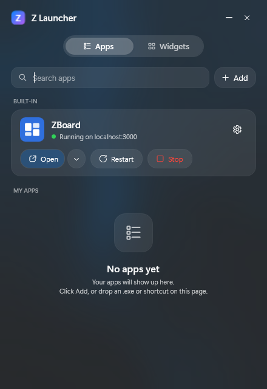

# Z Launcher

A frosted-glass launcher for Windows 11 with two sides behind a sliding pill: **Apps** and **Widgets**.

<table>
  <tr>
    <td align="center"></td>
    <td align="center"></td>
    <td align="center"></td>
  </tr>
  <tr>
    <td align="center"><b>Z Launcher</b>: Apps tab</td>
    <td align="center"><b>Z Launcher</b>: Widgets tab</td>
    <td align="center"><b>ZMonitor</b>: Memory collapsed, Network expanded</td>
  </tr>
</table>

| Side | What it does |
|---|---|
| **Apps** | The built-in **ZBoard** tile, then *your* apps (**My apps**, starts empty). Add an `.exe`, shortcut or script with **+ Add**, or drop it on the page. Search, launch (Enter launches the first match), and right-click for *Run as administrator*, *Open file location* or *Remove*. |
| **Widgets** | Manage desktop widgets. Today that's **ZMonitor**: on/off, per-section on/off (FPS, CPU, GPU, Memory, Network), Always on top, Lock position, Start with Windows, Opacity, Next monitor, Quit. |

**Ctrl+Alt+Z** shows or hides the launcher from anywhere, and **Esc** minimizes it. Click **Apps / Widgets** or press **Ctrl+Tab** to slide between the sides.
Apps are launched as your normal user. The launcher itself never runs as admin.
To make Z Launcher a widgets-only panel again, set `AppsEnabled = false` in [`MainWindow.xaml.cs`](src/ZLauncher/MainWindow.xaml.cs).

## ZBoard (built-in app)

ZBoard is a self-hosted board app that runs in WSL Ubuntu (`~/zboard`, port 3000).
Its tile is always on the Apps page:

* **Status**: polls `http://localhost:3000/` every few seconds while the Apps page is open. Any HTTP answer (even 401) counts as *Running*.
* **Open**: opens ZBoard through Tailscale in your default browser. The arrow next to it offers `http://localhost:3000` instead.
* **Start / Restart**: `wsl.exe -d ubuntu -- bash -l ~/.local/bin/zb-start` (restarts the server in the background).
  A hidden `wsl.exe` then stays attached while something listens on :3000, so WSL doesn't shut the idle distro down; it ends by itself after **Stop**.
* **Stop**: `wsl.exe -d ubuntu -- bash -lc "fuser -k 3000/tcp"`.
* **Settings** (gear, or right-click the tile):
  * **Environment**: edits `~/zboard/.env` as key/value rows. Comments, blank lines and order are kept; only changed lines are rewritten.
    Secrets (`APP_PASSWORD`, `GOOGLE_CLIENT_SECRET`, `GOOGLE_BACKUP_PASSPHRASE`, anything named `*SECRET*`, `*TOKEN*`, `*PASSWORD*`, `*PASSPHRASE*`) are masked, with a show/hide toggle.
    **Save and restart ZBoard** applies the changes. Values are never logged.
  * **Start at boot**: registers or removes the `ZBoard` scheduled task (at startup, before anyone logs in, restarts on failure).
    Windows asks for admin rights, then for your Windows password with its own credential prompt; Z Launcher never sees or stores it.
    The switch shows the task's state, its last run, and whether it uses an older command.
  * **Logs**: opens `~/zboard/data/server.log`, `~/zboard-autostart.log` (written by the boot task), or the `~/zboard` folder.

The boot task runs:

```
wsl.exe -d Ubuntu --exec bash -lc ". ~/.nvm/nvm.sh; cd ~/zboard && exec ./start.sh >> ~/zboard-autostart.log 2>&1"
```

It differs from ZBoard's `scripts/windows/install-autostart.ps1` in two ways. It uses double quotes, because `wsl.exe --exec` doesn't treat single quotes as quotes. It also loads nvm, because a non-interactive login shell never reaches the nvm lines in `~/.bashrc`, so `node` would be missing.
`start.sh` ends with `exec node`, so `wsl.exe` stays attached while ZBoard runs, which keeps WSL up.

The WSL paths and URLs are constants in [`ZBoardControl.cs`](src/ZLauncher/ZBoardControl.cs).

## Projects

| Path | What |
|---|---|
| [`src/ZLauncher`](src/ZLauncher) | The launcher (WPF, .NET 10, runs without admin) |
| [`src/ZMonitor`](src/ZMonitor) | Always-on-top hardware widget: FPS / 1% low / frame-time graph, CPU, GPU, RAM, network. See its [README](src/ZMonitor/README.md). |
| [`assets/z.ico`](assets) | App icon, generated by [`tools/make-icon.ps1`](tools/make-icon.ps1) |

## Download

Get `ZLauncher-<version>-win-x64.zip` from [Releases](https://github.com/endiluong/zlauncher/releases/latest), extract it, and run **install.cmd**.
You need the [.NET 10 Desktop Runtime (x64)](https://dotnet.microsoft.com/download/dotnet/10.0).

Releases are built by [GitHub Actions](.github/workflows/release.yml) whenever a `v*` tag is pushed:

```bat
git tag -a v1.1.0 -m "Z Launcher 1.1.0"
git push origin v1.1.0
```

## Build and install from source

Requires the .NET 10 SDK (or a per-user copy in `%LOCALAPPDATA%\Microsoft\dotnet-sdk`).

```bat
build.cmd
```

It publishes both apps to `%LOCALAPPDATA%\Programs\ZLauncher` and `%LOCALAPPDATA%\Programs\ZMonitor`, and adds a **Z Launcher** Start-menu shortcut.
Quit the widget first (Widgets > Quit widget), or run the script from an admin prompt, so the running ZMonitor can be replaced.

## How the launcher controls the widget

* Settings live in `%APPDATA%\ZMonitor\settings.json`. The launcher edits only the keys it owns and keeps the rest.
* It then posts the registered window message `ZMonitor.Command` (1 = reload, 2 = quit, 3 = next monitor). ZMonitor runs as admin and allows that message through UIPI.
* **Off** hides the widget and pauses all its polling, so turning it back on is instant and needs no UAC prompt.
  If the widget isn't running, the launcher starts it through the `ZMonitor` logon task when one exists (no prompt), or via UAC otherwise.
* Launcher settings (your apps, last tab, window position) are in `%APPDATA%\ZLauncher\settings.json`.
