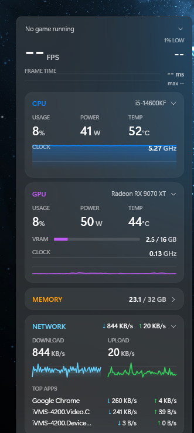

# ZMonitor

Frosted-glass, always-on-top hardware widget for Windows 11 (WPF / .NET 10).



| Shows | Source |
|---|---|
| FPS, 1% low, frame time of the foreground app | Real-time ETW session on the DXGI / D3D9 / DxgKrnl present events (the same events PresentMon uses). No RTSS / Afterburner, no injection into games. |
| CPU usage, package power, P-core clock graph, package temp | LibreHardwareMonitorLib 0.9.6 (reads MSRs through the [PawnIO](https://pawnio.eu) driver, which must be installed) |
| GPU usage, power, core clock graph, VRAM used/total, temp | LibreHardwareMonitorLib (AMD ADL) |
| RAM used / total | `GlobalMemoryStatusEx` |
| Network ↓/↑ (collapsible card, collapsed by default) | Counters of the adapter that has the default gateway, so WSL / Hyper-V virtual adapters are not double counted |
| Top 3 network apps (when expanded) | Microsoft-Windows-Kernel-Network ETW events (TCP/UDP, IPv4/IPv6, loopback excluded), averaged over 3 s. This capture only runs while the card is open. |

**Collapsible sections:** click any header (the chevron on the right) to fold that section. Each section's state is remembered.

| Section | Collapsed shows | Default |
|---|---|---|
| FPS | FPS only (hides 1% low and the frame-time graph) | open |
| CPU / GPU | usage % and temp in the header | open |
| Memory | used / total GB in the header | open |
| Network | ↓ / ↑ totals in the header | collapsed |

**Idle mode:** with no game running, the widget looks for a game once a second instead of 4×, and stops redrawing the FPS row.
Measured on an i5-14600KF: ~0.17% of total CPU while idle with the card collapsed, ~0.23% expanded, and ~190 MB RAM.
**Hidden** (from Z Launcher or the right-click menu): the window is gone and all polling stops.

If the expanded card would run past the bottom of the monitor, the widget slides up. It returns to its saved spot when collapsed.

FPS = presents in the last second. The 1% low is the average of the slowest 1% of frame times over the last ~10 s, shown as FPS.
The red **frame-time graph** plots each of the last 300 frames (refreshed 4× a second), with the average and the worst frame in ms. Spikes are stutters.

**Games only.** FPS follows the foreground app only when it is a game, and stays on that game while you alt-tab until it exits. A process counts as a game if:
1. Windows has recognised it as a game (Game Bar's list in `HKCU\System\GameConfigStore`), or
2. it runs from a game library folder (`steamapps\common`, Epic Games, XboxGames, Riot Games, GOG, EA Games, Ubisoft, ...), or
3. its window covers the whole monitor (fullscreen or borderless).

To force a game in or out, add exe names without `.exe` to `GameExes` / `IgnoreExes` in `settings.json`.
`IgnoreExes` already lists browsers, Explorer/Start search, launchers, Discord and similar apps.

## Run

* **Build and install:** run `build.cmd` at the repo root. It publishes to `%LOCALAPPDATA%\Programs\ZMonitor`.
* **Start / stop / configure:** from Z Launcher's **Widgets** tab, or run `ZMonitor.exe` directly. It asks for admin, which the sensors and ETW need.
* **Move it:** drag anywhere on the widget. Its position and monitor are saved to `%APPDATA%\ZMonitor\settings.json`.
* **Right-click menu:** Always on top, Lock position, Move to next monitor, Hide, Exit.
* **Settings file:** `Tint` (e.g. `#38000000`; higher alpha means darker glass), `Opacity` (0.3–1), `Show*` / `*Expanded` per section.
* **Control from other apps:** post the registered window message `ZMonitor.Command` to the window titled `ZMonitor`.
  wParam `1` = reload settings.json, `2` = quit, `3` = next monitor. The message is allowed through UIPI, so non-admin apps can send it.

## Start with Windows (no UAC prompt)

Z Launcher's **Start with Windows** switch sets this up (one UAC prompt). It registers a scheduled task with
"highest privileges" that starts the widget at logon. The same thing by hand, in an Admin PowerShell:

```powershell
$t=New-ScheduledTaskTrigger -AtLogOn -User $env:USERNAME; $t.Delay='PT10S'; Register-ScheduledTask -TaskName 'ZMonitor' -Trigger $t -Action (New-ScheduledTaskAction -Execute "$env:LOCALAPPDATA\Programs\ZMonitor\ZMonitor.exe") -User $env:USERNAME -RunLevel Highest -Settings (New-ScheduledTaskSettingsSet -ExecutionTimeLimit ([TimeSpan]::Zero) -AllowStartIfOnBatteries -DontStopIfGoingOnBatteries) -Force
```

To remove it: `Unregister-ScheduledTask -TaskName ZMonitor -Confirm:$false`

## Diagnostics

* `ZMonitor.exe --dump sensors.txt` writes every sensor LibreHardwareMonitor sees.
* `ZMonitor.exe --probe-fps fps.txt 6` records present events for 6 s and writes per-process FPS.
* Errors go to `%APPDATA%\ZMonitor\log.txt`.

## Notes

* Fullscreen-exclusive games cover a widget on the same monitor. On a second monitor it stays visible.
* Anti-cheat: the widget only reads OS-level ETW events and does not touch the game process.
